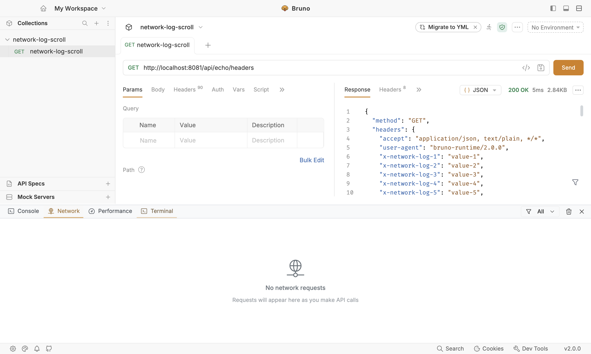
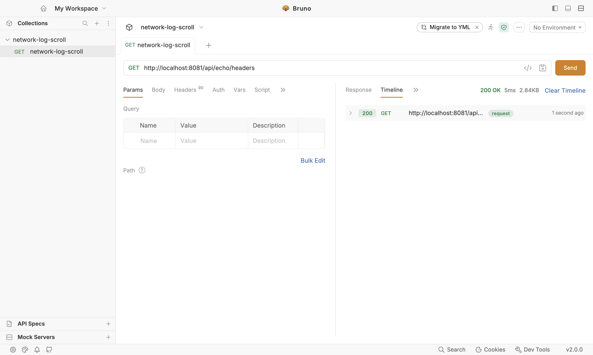

# Local verification — PR #9661 / issue #5790

Clear-all-network-calls feature, commit `1596e4363f4328696174f242579a5a2e1f1a322a`
(`test(devtools): use shared page modules in network clear spec`), on branch
`feature/network-tab-clear`.

## Environment

| | |
| --- | --- |
| OS | macOS 27.0.1, arm64 (Apple Silicon) |
| Node | v26.12.1 |
| Electron | 37.6.1 (darwin-arm64) |
| @playwright/test | 1.62.1 |
| Command runner | zsh, repo root |

This is a native macOS run of the same Electron app the `tests-macos.yml`
workflow's "Playwright E2E Tests (macOS)" job runs. It is **not** a Windows or
Linux run — those jobs are `action_required` on the PR (first-time contributor
approval gate) and will execute once a maintainer approves them.

## 1. Playwright E2E — new spec plus the neighbouring Network spec

```
$ npx playwright test tests/devtools/network --project=default --workers=1
Running 2 tests using 1 worker

  ✓  1 [default] › tests/devtools/network/network-clear-logs.spec.ts:15:7 ›
        DevTools Network Tab Clear › clears every network request row from the Network tab (6.3s)
  ✓  2 [default] › tests/devtools/network/network-log-details-scroll.spec.ts:26:7 ›
        DevTools Network Log Details Scroll › last network log lines are visible and scrollable
        in request details panel (6.3s)

  2 passed (36.4s)
```

Machine-readable result (`playwright-report/results.json`):

```json
"stats": {
  "startTime": "2026-10-27T03:32:23.838Z",
  "duration": 36407.35,
  "expected": 2,
  "skipped": 0,
  "unexpected": 0,
  "flaky": 0
}
```

The spec exercises the real UI end-to-end: send a request, open DevTools →
Network, confirm the row exists, click the clear control, assert zero rows and
the empty state.

## 2. Unit / component tests

```
$ npm run test --workspace=packages/bruno-app -- \
    src/components/Devtools/Console/NetworkTab/index.spec.js \
    src/providers/ReduxStore/slices/collections/index.spec.js

Test Suites: 2 passed, 2 total
Tests:       34 passed, 34 total
```

## 3. ESLint on the changed files

```
$ npx eslint <11 changed files>
✖ 14 problems (0 errors, 14 warnings)
```

All 14 warnings are pre-existing dead code in untouched code paths (unused
`debugErrors` / `filteredRequests` / `filteredLogs` locals, commented-out
`IconBug` block, pre-existing `eqeqeq` violations in the collections slice).

## How to inspect this evidence

`playwright-report.zip` contains the full Playwright HTML report, including the
trace of the passing run. Unzip and open `playwright-report/index.html`, click
the test, and step through each action with DOM snapshots and screenshots.

A standalone `trace-network-clear-logs.zip` is included for the new spec. Open
<https://trace.playwright.dev> and drag it in, or pass it via `?trace=` if a
URL is available.

## 4. Follow-up — independent Network and Response Timeline history

Commit `421474cf810ed3f39a8cb309980802e3cedace4f` separates the Network
history index from each request's Response Timeline index while keeping
canonical request events shared. Clearing Network now leaves the request's
Response Timeline entry intact; clearing a request's Timeline leaves its
Network entry intact. Late HTTP responses from runs started before Clear do not
repopulate the Network list.

### Verification

```
$ npx playwright test tests/devtools/network --project=default --workers=1 --timeout=60000
2 passed (35.8s)

$ npm run test --workspace=packages/bruno-app -- \
    src/components/Devtools/Console/NetworkTab/index.spec.js \
    src/components/ResponsePane/Timeline/index.spec.js \
    src/providers/ReduxStore/slices/collections/index.spec.js \
    src/providers/ReduxStore/slices/collections/timeline-routing.spec.js \
    src/providers/ReduxStore/slices/collections/grpc-script.spec.js
Test Suites: 5 passed, 5 total
Tests: 100 passed, 100 total

$ npx eslint <changed files>
0 errors, 33 pre-existing warnings
```

### Screenshots from the passing Playwright run

After Clear, the Network tab is empty:



The request remains in the Response Timeline:


